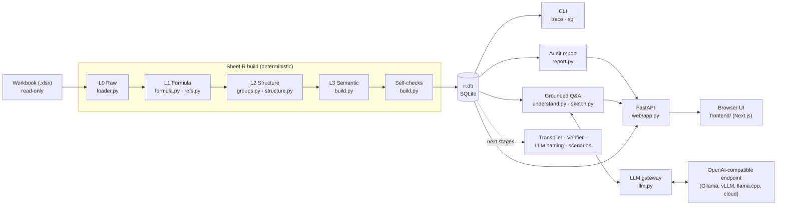

# SheetTwin — SheetIR

**SheetIR** is the first stage of SheetTwin, a local system that turns business
spreadsheets into verified, explainable digital twins. SheetIR parses an Excel workbook into a layered,
queryable **intermediate representation (IR)** stored in a single SQLite file. Every later stage (Python
transpilation, verification, explanations, Q&A) is built on this IR.

Parsing, auditing and the audit report are **deterministic Python**. A language model is optional and used only by
the chat, through any OpenAI-compatible endpoint (a local server such as Ollama, vLLM or llama.cpp, or a cloud API).
SheetIR, not the model, decides what an answer may rest on: questions about the data are answered from read-only SQL
queries that SheetIR runs, and every number in an answer is checked against them. With no model configured, or with a
local one, no data leaves the machine.

> **Status: proof of concept (v0.1).** SheetIR parses, structures and audits a workbook, writes an audit report, and
> answers questions about it with a grounded language model. It does **not yet compute** anything: there is no Python
> translation, no L1/L2 verification, and no what-if scenarios. See [Status and roadmap](#status-and-roadmap).

---

## Contents

- [What it does](#what-it-does)
- [Quick start](#quick-start)
- [Web UI](#web-ui)
- [Chat with a language model](#chat-with-a-language-model)
- [Audit report](#audit-report)
- [Command line](#command-line)
- [Architecture](#architecture)
- [How the analysis works](#how-the-analysis-works)
- [Storage format](#storage-format)
- [Detected issues](#detected-issues)
- [Self-checks](#self-checks)
- [Example queries](#example-queries)
- [Project layout](#project-layout)
- [Testing](#testing)
- [Status and roadmap](#status-and-roadmap)

---

## What it does

Given an `.xlsx` workbook, SheetIR produces:

| Output | Example (bundled sample workbook) |
|---|---|
| Every non-empty cell with its **role** | 251 cells classified as input, derived, output, label or orphan |
| **Formula groups**: cells that perform the same computation | 108 formulas → 13 groups (e.g. the 21-cell *Margin* column is one group) |
| **Tables** with a key column, fields and total row | `quote` (20 products, key = *Product*), `materials` |
| **Parameters** named from nearby labels, with units and allowed range | `copper_price` (TWD/kg, 100–1000), `labor_rate` (from defined name `LaborRate`) |
| A **semantic address** for every cell | `Quote!J13` → `quote["Cover plate"].margin` |
| The **dependency graph** | Trace any number back to its inputs |
| **Relations** read from lookups and conditional aggregates | `quote.material` → `materials.code`, returning `price_factor` (exact `VLOOKUP`, 20 cells) |
| **Issues** found during parsing | Inconsistent formula in a column, constant typed over a formula, hard-coded `1.15`, unused values, `TODAY()`, `INDIRECT` |
| **Self-check** results | Formula coverage, independent re-derivation of groups, cycle detection |
| An **audit report** (HTML, printable to PDF, or Markdown) | 9 findings by severity, each explained, with the parse verification |
| **Answers** to questions, grounded in the IR (optional language model) | *Which products use material CU?* → the 9 products, from a SQL query, numbers checked |

The original workbook is never modified.

---

## Quick start

### With Docker (just to use it)

Requirements: [Docker](https://docs.docker.com/get-docker/) (Docker Desktop on Windows and macOS). No Python, Node or
uv needed.

```bash
docker compose up --build    # http://localhost:8765 (first build takes a few minutes)
```

After pulling new code, run the same command again to rebuild. Uploads and SheetIR databases live in the Docker volume
`sheettwin-data`, so they survive rebuilds (`docker compose down -v` deletes them). To enable the LLM features, put
`OPENAI_API_KEY=...` (and optionally `SHEETIR_LLM_MODEL`, `OPENAI_BASE_URL`) in a `.env` file next to
`docker-compose.yml`; it is read when the container starts and never copied into the image.

### From source (to work on it)

Requirements: [uv](https://docs.astral.sh/uv/) (it installs Python 3.11+ and all dependencies) and
[Node.js](https://nodejs.org/) 20+ for the chat UI.

```bash
uv sync                      # create .venv and install dependencies

# build the chat UI once (and again after changing frontend/)
cd frontend
npm install
npm run build                # writes sheetir/web/static/app (git-ignored)
cd ..

# optional: answer chat questions with a language model (see "Chat with a language model")
cp .env.example .env         # then edit it: endpoint, key, model

uv run sheetir serve         # http://127.0.0.1:8765
```

`uv run` installs any dependency added since the last sync (from `uv.lock`) before starting, so after a pull there is
no separate `uv sync` step. Run `sheetir serve` from the repository root: `.env` and the default `data/` folder are
found relative to the current directory.

| URL | Page |
|---|---|
| `http://127.0.0.1:8765/` | Landing page: what SheetTwin does, with screenshots (for demos and reviewers) |
| `http://127.0.0.1:8765/app/` | Chat UI: talk to a workbook, upload new data, browse converted files |
| `http://127.0.0.1:8765/legacy` | Structure browser: grid, issues, model, SQL |

The built chat UI is not committed, so after cloning you need the `npm run build` step. Without it, `/`
shows the structure browser instead.

Without Node, skip the `frontend` step and use the structure browser.

### Working on the chat UI

Run the backend and the Next.js dev server side by side. The dev server reloads on every change and
proxies `/api` to the backend:

```bash
uv run sheetir serve         # terminal 1: backend on :8765
cd frontend && npm run dev   # terminal 2: open http://localhost:3000
```

Set `SHEETIR_API` if the backend is not on `http://127.0.0.1:8765`. When you are done, run
`npm run build` so `sheetir serve` picks up the changes.

In the UI, either drop in an `.xlsx` file or load the sample workbook.

Without the UI:

```bash
uv run sheetir sample samples/quotation.xlsx            # generate the sample workbook
uv run sheetir build  samples/quotation.xlsx -o out/q.db
uv run sheetir trace  out/q.db "Quote!J13" --depth 2
uv run sheetir sql    out/q.db "SELECT cell_id, kind, detail FROM issues"
```

### Sample workbook

`sheetir sample` writes a synthetic quotation workbook (4 sheets, 20 products) with deliberately planted problems:

| Cell | Planted problem | Detected as |
|---|---|---|
| `Quote!I13` | Overhead factor 1.12 instead of 1.15 | `inconsistent_formula` |
| `Quote!G17` | Labor cost typed as `3250` in a formula column | `hardcoded_in_formula_column` |
| `Quote!I*` | Overhead `1.15` hard-coded in 19 formulas | `hardcoded_constant` |
| `Inputs!B9` | Value that no formula uses | `orphan` |
| `Report!B1` | `=TODAY()` | `volatile` |
| `Report!B6` | `=INDIRECT(...)` | `dynamic_ref` |

As a side effect, SheetIR also flags `Quote!E17` as an orphan: because `G17` was typed over, that row's labor hours no longer affect anything.

---

## Web UI

`uv run sheetir serve` starts a local FastAPI server that serves two pages and the HTTP API. Neither page loads anything from a CDN or makes external requests, so both work offline.

| Option | Default | Meaning |
|---|---|---|
| `--host` | `127.0.0.1` | Use `0.0.0.0` to share with colleagues on the LAN |
| `--port` | `8765` | |
| `--data` | `data` | Where uploads and IR databases are stored |

**Landing page (`/`)**: the product pitch, written for reviewers and demos: the problem, the four features with
screenshots, how it works (L0–L3) and the issues found in the sample workbook. "Try the sample" opens `/app/?sample=1`,
which loads the sample workbook. Copy is in `frontend/src/lib/landing-i18n.ts`.

The screenshots in `frontend/public/screenshots/{zh,en}/` are committed. After changing the UI, re-shoot them with the
app built and a backend on an empty data folder (so the sidebar shows only the sample):

```bash
uv run sheetir serve --data <empty folder>
cd frontend && npm run screenshots   # uses an installed Edge or Chrome
npm run build                        # include the new screenshots
```

**Chat UI (`/app/`)**, built from `frontend/` (Next.js, React, Tailwind):

| Part | Contents |
|---|---|
| **新增資料** button | Upload dialog: drag and drop an `.xlsx`/`.xlsm`/`.xls`/`.ods`/`.csv`, or load the sample workbook |
| **轉換檔案** button | Files derived from the workbook (original, `ir.db`, `model.json`, CSVs, and the [audit report](#audit-report) as HTML and Markdown), with preview and download. The HTML report opens in a new tab, where it can be printed or saved as PDF; reports are written in the UI language |
| **工作表結構** button | Sheet structure: a spreadsheet-like grid of each sheet. *Structure* tints every detected table (header rows, body, total row, key column) and outlines it, and marks parameters and outputs outside tables; *Roles* colors cells as input, computed, output or unused. Issue cells are outlined, *Show formulas* shows formulas instead of values, and the tables on the sheet are listed above the grid. Clicking a table shows its header, body, key and fields; clicking a cell shows where it sits (*table quote → row "Cover plate" → field margin*), its formula and R1C1 pattern, its calculation group, its issues (explained), its sources and users, with links to the dependency graph and the chat. A banner offers **Re-parse** when the result was built with an older IR schema |
| **SQL 查詢** button | SQL against the workbook's SheetIR database, with example queries and the tables and columns of the schema (click to insert). Only `SELECT`/`WITH` is accepted and the database is opened read-only; up to 500 rows, downloadable as CSV. Cell ids in the result open the cell in the sheet structure view |
| **依賴圖** button | Dependency graph. *Overview*: one node per formula group, table data column or standalone input, so a filled-down column is a single node. *Cell trace*: a cell's precedents (3 levels up) and dependents (2 levels down). Hovering a node highlights its whole calculation chain; nodes with issues get a badge |
| **圖表** button | Charts. Structure and audit: cell roles and issue severity (donuts), issue kinds, cells and formulas per sheet. Table data: pick a detected table and a numeric column, shown per row (bars) or summed by a text column (donut or bars), with a data-table view. Formula columns only have values if the file was last saved by Excel |
| Workbook list | One row per file name. Results of the same file name with different content are its versions (`v2/3`); the arrow lists them with upload date and result id, and each can be removed. Each result keeps its own chat history (stored in the browser) |
| **轉換檔案** → *Source file* | Where the result came from: file name (and other names the same bytes were uploaded under), version, SHA-256, size, the file's modified time on your machine, first and last upload, and the SheetIR version, IR schema and header scorer that parsed it. *Compare with another version* lists the cells added, removed or changed (value or formula), or says the cell contents are identical |
| Chat | Questions about the workbook in plain language: what it does, its tables, formulas and parameters, its data (*which products use CU?*, *total steel use?*) and its issues. With a [language model](#chat-with-a-language-model) configured, a reply shows the model, whether every number in it was checked against the data, and the SQL query it ran. A message that is only a cell id such as `Quote!J13` gets a card with its formula, group, issues and calculation chain. Cell ids in a reply are clickable, and replies about a cell link to its dependency graph |

Without a language model, or when the model fails, the chat answers with built-in rules (`sheetir/web/chat.py`):
the summary, issues, parameters, tables, outputs, checks, or a cell. A reply from the rules after a model failure says so.

The UI is bilingual: the **中 / EN** button at the bottom of the left rail switches between Traditional Chinese
and English, including chat replies (`lang` in the chat request). UI strings live in
`frontend/src/lib/i18n.tsx`, reply strings in `MSG` in `chat.py`. The choice is remembered in the browser.

**Structure browser (`/legacy`)**, the single file `sheetir/web/static/index.html`:

| Tab | Contents |
|---|---|
| **Overview** | What was found, in plain sentences; key counts (tables, parameters, results, calculations, lookups, issues); each parsing step with its numbers and self-checks; a minimap of every sheet showing its tables, inputs, results and issues; the issues that need attention, explained; how to query the result |
| **Sheets** | Spreadsheet-like grid in two modes. *Structure* tints each detected table (header rows, body, total row, key column) and outlines it, and marks parameters and results outside tables; *Roles* colors cells as input, derived, result or unused. Issue cells are outlined, a *formulas* switch shows formulas instead of values, and the tables on the sheet are listed above the grid. Clicking a table shows its header, body, key and fields; clicking a cell shows where it sits (*table quote → row "Cover plate" → field margin*), its formula and pattern, its calculation group, its issues (explained), and its precedents and dependents. Every reference is clickable, including other sheets |
| **Tables & names** | Tables with their fields (*Show on sheet*), parameters (value, unit, allowed values), results outside tables, lookups between tables, and calculation groups |
| **Issues** | All issues with a plain-language explanation, filterable by severity; click to jump to the cell |
| **SQL** | Ad-hoc SQL against the IR, with preset queries. Only `SELECT`/`WITH` is accepted, and the database is opened read-only |

The header also offers **Download .db** (the SheetIR database, for any SQLite tool) and **Re-parse** (parse the
stored copy again after upgrading SheetIR; a banner suggests it when a database was built with an older IR schema).
The address bar keeps the current view (`#wb=…&view=sheet&sheet=Quote&cell=Quote!J13`), so links and reloads land on
the same cell. Loading the sample again reuses the same entry; the ✕ beside a workbook removes the stored copy and
its database (never the original file).

### HTTP API

| Method | Path | Returns |
|---|---|---|
| `GET` | `/api/workbooks` | Every result with its source record (name, aliases, SHA-256, size, file modified, first/last upload, upload count), how it was parsed, and its version among results of the same file name; most recently uploaded first |
| `POST` | `/api/workbooks` | Upload (`multipart/form-data`: `file`, optional `last_modified` in ms) and parse. Returns `duplicate: true` when the same bytes were uploaded before (the result is reused, re-parsed only if its IR schema is outdated) |
| `GET` | `/api/workbooks/{id}/user-tables` | The user's table corrections, per sheet |
| `PUT` | `/api/workbooks/{id}/user-tables/{sheet}` | `{"tables": [{"range", "header_rows", "total", "name"?}]}`: use these tables on the sheet, re-parse and verify. Refused with `bad_range`, `too_small` or `overlap` |
| `DELETE` | `/api/workbooks/{id}/user-tables/{sheet}` | Back to automatic detection on the sheet, re-parse |
| `GET` | `/api/workbooks/{id}/diff?against=` | Cells added, removed or changed from another result (e.g. the previous version) to this one |
| `POST` | `/api/workbooks/sample` | Generate and parse the sample workbook |
| `GET` | `/api/workbooks/{id}/summary` | Metadata, counts, per-sheet stats, checks, issue counts, whether the IR schema is outdated |
| `GET` | `/api/workbooks/{id}/sheet?name=` | Cells, issues, tables (with fields) and parameters of one sheet |
| `GET` | `/api/workbooks/{id}/layout` | Compact per-sheet maps (cell role, table, issue severity) for the minimaps |
| `GET` | `/api/workbooks/{id}/db` | The SheetIR database file |
| `POST` | `/api/workbooks/{id}/rebuild` | Parse the stored copy again with the current SheetIR |
| `DELETE` | `/api/workbooks/{id}` | Remove the stored copy and its database |
| `GET` | `/api/workbooks/{id}/cell?id=&depth=` | One cell with its group, issues, precedents and dependents |
| `GET` | `/api/workbooks/{id}/issues` | All issues |
| `GET` | `/api/workbooks/{id}/model` | Tables, fields, parameters, outputs, groups, relations |
| `POST` | `/api/workbooks/{id}/sql` | `{"query": "..."}` → columns and rows (max 500) |
| `POST` | `/api/workbooks/{id}/chat` | `{"message": "...", "lang": "zh" \| "en"}` → `{"reply": markdown, "cells": [...], "source": "llm" \| "rules"}`. From the model also `model`, `route` (`structure`, `data` or `issues`), `sql`, `grounded` and `ungrounded` (numbers that could not be checked); after a model failure, `fallback` with the reason. `lang` is the UI language, used when the question's own language cannot be told |
| `GET` | `/api/llm` | `{"enabled": bool, "model": name}`: whether the chat uses a language model |
| `GET` | `/api/workbooks/{id}/graph?cell=&up=&down=` | Block-level dependency graph; with `cell`, that cell's neighbourhood |
| `GET` | `/api/workbooks/{id}/charts` | Role/issue/sheet statistics and the rows of every table (constants, or cached values for formulas) |
| `GET` | `/api/workbooks/{id}/exports?lang=` | Converted files: name, label, format, size |
| `GET` | `/api/workbooks/{id}/exports/{name}?lang=&inline=` | Download one file (`ir.db`, `model.json`, `cells.csv`, `issues.csv`, `formula_groups.csv`, `audit_report.html`, `audit_report.md`, or the original workbook). Reports are written in `lang` (`zh` by default, or `en`); `inline=true` opens a report in the browser instead of downloading it |

---

## Chat with a language model

The chat can answer with a language model (`sheetir/understand.py`) through any endpoint that speaks the OpenAI Chat
Completions protocol with JSON-schema output. All calls go through `sheetir/llm.py`, so the model and runtime are
configuration. Copy `.env.example` to `.env` (git-ignored) and set:

| Variable | Meaning | Default |
|---|---|---|
| `OPENAI_API_KEY` | Turns the model on. Local servers ignore its value, but it must not be empty | (unset: rules only) |
| `OPENAI_BASE_URL` | Endpoint, e.g. Ollama at `http://<host>:11434/v1`, vLLM or llama.cpp at `http://<host>:8000/v1` | `https://api.openai.com/v1` |
| `SHEETIR_LLM_MODEL` | Model name as the endpoint knows it, e.g. `qwen3:30b-a3b` on Ollama | `gpt-5.4-mini` |

Environment variables take precedence over `.env`. `GET /api/llm` shows whether the model is on.

**Ollama.** To serve another machine on the LAN, start Ollama with `OLLAMA_HOST=0.0.0.0`. Also raise its context
length (`OLLAMA_CONTEXT_LENGTH=32768`): its default is short, and a longer prompt is cut without an error, which shows
up only as poor answers. Each model call times out after 120 s, so the first question after the model is loaded may be
slow.

**What the model sees.** A compact sketch of the parsed workbook (`sheetir/sketch.py`: sheets, tables with their
fields and a few sample rows, parameters, results, lookups, issues), the database schema, the question, and the rows
of the queries SheetIR runs for it. Never the file itself. With a cloud endpoint this content leaves the machine;
use a local server for confidential workbooks.

**How an answer is made.** SheetIR enforces each step; the prompt alone is not trusted to:

1. The model classifies the question: **structure** (what the workbook does, its tables, formulas, parameters),
   **data** (anything about table rows: which, how many, totals, the most or least) or **issues**.
2. **Data** questions must come with one SQL query; SheetIR runs it read-only (at most 60 rows) and asks the model
   once more if it wrote none, or if the query failed or found nothing. A data question is never answered from the
   sketch's sample rows; without a query the reply says it could not look it up. **Issues** questions get SheetIR's
   full issue list with counts by severity and kind. **Structure** questions are answered from the sketch.
3. The model writes the answer from that material, in the language of the question (decided by SheetIR, not the model).
4. SheetIR checks the answer:
   - **Language**: a reply in the wrong language is rewritten once.
   - **Numbers**: every number must appear in the material the answer was written from, to the precision shown
     (15% may stand for 0.15). Otherwise the answer is rewritten once; if numbers are still unchecked, a data answer
     is replaced by the query result as a table, and any other answer carries a note listing them.
   - **Cells**: cell ids are looked up in the database; only cells that exist become links in the reply.
   - If the workbook holds no results calculated by Excel and the query found none, the reply says so.

A message that is only cell ids gets the rule-based cell card, and any model failure falls back to the rules.

**Evaluation.** `bench/eval_qa.py` asks the configured model 14 questions about the sample workbook (table rows,
counts, totals, values, issues, structure; English and Chinese) and scores each reply against expected answers read
from the IR by SQL: every expected item named, no excluded item named, and the reply in the language of the question.

```bash
uv run python bench/eval_qa.py --repeat 2 -o qa.json
```

| `qwen3:30b-a3b` on Ollama, 14 questions × 2 runs | Passed | Median time per question |
|---|---|---|
| Model decides whether to query and which language to use | 23/28 | ≈7 s |
| SheetIR enforces the query, the language and the number check | 28/28 | ≈12 s |

The failures before were replies in English to Chinese questions (4) and a wrong item in a list (1). These figures
come from the synthetic sample only, not from real-world workbooks.

---

## Audit report

`sheetir/report.py` writes an audit report from the IR with fixed queries; no language model is involved, so the same
database always gives the same report. It contains:

1. **Summary**: issues by severity, what to fix first, parse status, workbook size (sheets, cells, formulas, groups,
   tables, parameters), and a note when the file holds no values calculated by Excel.
2. **Findings**, by severity and then by kind: a plain-language explanation of the kind, and for each finding its cell,
   semantic location, formula and technical detail.
3. **Parse verification and coverage**: the independent re-read checks, formulas that cannot be traced fully, parts of
   the file SheetIR does not model, and the self-checks.
4. **About this report**: how it was produced and what rule-based checks cannot prove.

It comes as a self-contained HTML page (no external resources, with print styles, so the browser can save it as PDF)
and as Markdown with the same content, in Traditional Chinese or English. In the web UI it is under **轉換檔案**; over
HTTP it is `/api/workbooks/{id}/exports/audit_report.html` or `.md` with `?lang=zh|en`. The technical detail column is
the raw output of SheetIR's rules (English, R1C1 notation).

---

## Command line

| Command | Description |
|---|---|
| `sheetir sample [OUT]` | Write the sample workbook (default `samples/quotation.xlsx`) |
| `sheetir build XLSX [-o DB] [--tables hand\|model]` | Parse a workbook; prints counts, checks and issues. `--tables model` recognizes header rows with the trained classifiers. Exits with code 1 if an error-level check fails |
| `sheetir trace DB CELL [--depth N]` | Print the precedent tree of a cell, e.g. `Quote!J13` |
| `sheetir sql DB QUERY` | Run SQL against an IR database |
| `sheetir serve [--host] [--port] [--data]` | Start the web UI |

`python -m sheetir ...` works as well.

---

## Architecture



The IR has four layers. Each layer is derived from the one below it:

| Layer | Holds | Built by |
|---|---|---|
| **L0 Raw** | Cells, constants, formulas, cached values, number formats, Excel Tables, defined names, data validation | `loader.py` |
| **L1 Formula** | Tokens, resolved references (A1, cross-sheet, defined names, `Table[Column]`), R1C1 templates, literals, dependency edges | `formula.py`, `refs.py` |
| **L2 Structure** | Formula groups, tables (header, key column, total row, fields), cell roles, anomalies, relations | `groups.py`, `structure.py`, `relations.py` |
| **L3 Semantic** | Names for parameters, fields and outputs; semantic address of every cell | `build.py` (slugs from labels; LLM renaming is a later stage) |

---

## How the analysis works

### 1. Read the workbook (L0)

`openpyxl` opens the file **twice**: once for formulas and once with `data_only=True` for the values Excel last calculated. The cached values are the ground truth for later L1 parity checks. The loader also reads Excel Tables, defined names (global and sheet-scoped), data validation rules and merged ranges. Array formulas and data tables are flagged.

### 2. Parse formulas and normalize references (L1)

Each formula is split by openpyxl's tokenizer. Range operands are then resolved:

- **A1 references**, including `$` anchors, whole columns/rows and quoted sheet names, are parsed by `refs.parse_ref`.
- **Defined names** are resolved to their target ranges.
- **Structured references** (`Sales[Amount]`, `[@Qty]`, `Sales[[#This Row],[Price]]`) are resolved against Excel Tables.
- **External links**, `#REF!`, unknown sheets and unresolvable names become issues.

Every reference is converted to **relative R1C1 form**, which makes a formula independent of its position:

```
F2:  =D2*E2*$H$1   →  =RC[-2]*RC[-1]*R1C8
F3:  =D3*E3*$H$1   →  =RC[-2]*RC[-1]*R1C8     same key = same computation
```

Ranges are kept as single nodes and are not expanded cell by cell, so `VLOOKUP(x, A1:Z10000, …)` adds one edge, not 260,000. Numeric literals are recorded with the function that encloses them. This lets the auditor ignore structural arguments such as a `VLOOKUP` column index.

### 3. Group formulas (L2)

Adjacent cells with identical R1C1 keys are grouped: first down columns (`axis = col`), then across rows (`axis = row`). Anything left over becomes a single-cell group. A group is one vectorizable computation. Later stages name, explain and translate groups, not thousands of individual cells.

### 4. Detect tables and roles (L2)

- **Tables**: declared Excel Tables are used first. Otherwise, a run of two or more adjacent header-like cells is **scored** as a possible header (`HandScorer` in `tablemodel.py`, threshold 0.7), and needs at least two body rows below it. Header-like cells are text, dates, runs of consecutive years (`2023 | 2024 | 2025`), and numbers or formulas formatted as headers (bold, fill or bottom border). Evidence adds up:

  | Signal | Weight |
  |---|---|
  | Share of cells that read as labels (text, date, year run, or formatted unlike the cell below) | 0.40 |
  | Some column switches from a label to a value below the header | 0.30 |
  | ... scaled by the share of columns that do | 0.15 |
  | Share of cells formatted unlike the cell below | 0.30 |
  | Share of columns where a filled-down formula group starts right below | 0.30 |
  | Header labels are distinct | 0.10 |

  Plain text labels over numbers pass on their own. Formatting lets all-text tables and numeric headers pass, and formula columns raise the score. The score is stored as the table's `confidence`. Header cells that a formula references individually are treated as input values, not headers.

  `sheetir build --tables model` (or `build_ir(..., table_scorer="model")`) uses classifiers trained on StatSheets instead, for both the header row and the header rows above it; the confidence is then the model's probability. They are more accurate on statistical tables (see [Table detection benchmark](#table-detection-benchmark)) but were trained without formulas, so they miss some business layouts the hand weights handle: styled all-text tables, formula columns as evidence, and a form field (`Customer | ACME`) directly above a header. The scorer used is recorded in `meta.table_scorer`.
- **Header rows**: the header is compared with the first row below it that holds values, so a units row (`$m | $m`) or a section heading may sit in between. Up to ten rows directly above the header row are joined into field headers (`2024 / Q1`) when they hold two or more labels that are merged across columns, merged down, written once and left blank to their right, or fill most columns (series metadata such as unit and frequency). A single title, or a blank row, ends the header.
- **Stub column**: a column to the left with an empty header cell over text labels (row names in statistical tables) joins the table, also across one empty spacer column.
- **Side by side**: detected tables at most one column apart, with headers within one row of each other and nearly the same body rows, are one table split by spacer columns and are merged.
- **Body**: the body runs down while rows have content. Up to three rows that are empty across the table's value columns (blank rows, or section headings in the stub column) are skipped when the row after them continues the same label/value pattern per column; they are recorded as gaps (not rows with missing formulas). A new header after them, or four such rows, ends the table. A trailing row with a "Total" label, or an aggregate over the column above, becomes the **total row**, also after a blank row. The first all-text, unique column becomes the **key column**.
- **Fields**: a column whose cells are mostly formulas is `derived`, and its majority R1C1 key is the column's pattern. Cells that break the pattern are reported as issues.
- **Roles** come from the dependency graph:

| Role | Rule |
|---|---|
| `input` | Constant that a formula references |
| `derived` | Formula that another formula references |
| `output` | Formula that nothing references |
| `label` | Text that nothing references |
| `orphan` | Non-text constant that nothing references |

### 5. Read relations from formulas (L2)

Table boundaries and names are guesses; a lookup formula is a fact. `=VLOOKUP(B2, Materials!$A$2:$C$4, 3, FALSE)`
says that `B2` is matched against `Materials!A2:A4` and that the answer comes from `Materials!C2:C4`. The formula
parser records every function call with its arguments (nested calls included), and `relations.py` turns the
following calls into relations:

| Function | Value | Matched against | Returns | Match mode |
|---|---|---|---|---|
| `VLOOKUP` / `HLOOKUP` | 1st argument | First column / row of the table | Column / row given by the index | `exact` only with `FALSE`/`0`; omitted means `approximate` |
| `XLOOKUP` | 1st | 2nd | 3rd | `exact` by default; `approximate` (`-1`/`1`), `wildcard` (`2`) |
| `INDEX(…, MATCH(…))` | `MATCH` 1st | `MATCH` 2nd | `INDEX` array (or its column) | From `MATCH`; recorded once as `INDEX/MATCH` |
| `MATCH` / `XMATCH` alone, `LOOKUP` | 1st | 2nd | `LOOKUP` 3rd, otherwise none | `MATCH` defaults to `approximate`, `XMATCH` to `exact` |
| `SUMIF(S)`, `COUNTIF(S)`, `AVERAGEIF(S)`, `MAXIFS`, `MINIFS` | Criterion | Criteria range (one relation per pair) | Aggregated range | `equal` when the criterion is a plain cell, else `condition` |

Each relation is then placed on the detected tables. The table holding the lookup value is the **from** side, and the
table holding the key range is the **to** side, with field names where a range is exactly one column. This is the
equivalent of a foreign key. A range computed at run time (`INDIRECT`, `OFFSET`) is recorded with no key range.

An approximate lookup over a mostly-text key range is reported as `approximate_lookup`, because it silently returns
wrong rows unless the keys are sorted. Approximate lookups over numbers (bracket tables) are legitimate and are not
reported.

### 6. Name things (L3)

- **Parameters**: inputs outside tables. Each is named from the label to its left (or above) or from a defined name, and labels like `Copper price (TWD/kg)` are split into a name (`copper_price`) and a unit (`TWD/kg`). Data validation rules become the parameter's domain. A two-column *label | value* block whose values are referenced one by one is treated as a parameter list.
- **Table cells**: `table["row key"].field`, and `table.total.field` for total rows.
- **Other formulas**: `outputs.<label>` or `calc.<label>`.

Names are deterministic slugs. A later stage will let an LLM propose better names; only names change, never structure.

---

## Storage format

### Which file produced which result

The web server keeps each result in `data/<id>/`, where `<id>` is the first 12 hex digits of the SHA-256 of the
uploaded bytes. The same file content therefore always maps to the same result, and uploading it again opens that
result instead of adding another. Each folder holds:

| File | Contents |
|---|---|
| `<name>.xlsx` | Copy of the upload, named as at the first upload (the user's file is never touched) |
| `ir.db` | The SheetIR database; `meta` records the source SHA-256, SheetIR version, IR schema, header scorer and build time |
| `source.json` | Provenance: `name`, `aliases` (other names the same bytes were uploaded under), `sha256`, `size`, `file_modified` (the file's modified time on the uploader's machine, sent by the browser), `first_uploaded`, `last_uploaded`, `uploads` |

Results with the same file name (case-insensitive) are versions of one workbook, numbered by first upload. Downloaded
files carry the result id in their name (`quotation.0e2581ad6369.sheetir.db`), so a database on disk still says which
upload it came from; its `meta.sha256` gives the full hash of the source file. Results stored before `source.json`
existed get a record rebuilt from `ir.db` (with the build time as upload time and no file-modified time).

### Location

| Used from | Location |
|---|---|
| CLI | Path given with `-o`, default `<workbook>.sheetir.db` next to the workbook |
| Web UI | `data/<id>/ir.db`, plus a copy of the uploaded file and `source.json` in `data/<id>/`; `<id>` is the first 12 hex characters of the file's SHA-256 (see above) |

Each build **replaces** the previous database at that path; version history is not kept yet. `data/`, `out/` and `*.sheetir.db` are git-ignored.

### Schema

One SQLite file per workbook. Every table is keyed by a canonical cell id such as `Quote!J13` or `'My Sheet'!A1`.

| Table | One row per | Key columns |
|---|---|---|
| `meta` | Build attribute | `source`, `sha256`, `sheetir_version`, `sheets` (ordered JSON list), `built_at` |
| `cells` | Non-empty cell | `cell_id`, `sheet`, `row`, `col`, `vtype`, `role`, `value`, `cached`, `formula`, `r1c1`, `group_id`, `table_id`, `semantic`, `number_format` |
| `formula_groups` | Formula group | `group_id`, `axis`, `anchor`, `last`, `n_cells`, `r1c1`, `template` (tokens + relative refs, JSON) |
| `edges` | Reference in a formula | `src_kind` (`cell`/`range`), `src_id`, `dst_cell`, `via` (`direct`, `name:<NAME>`, `structured`) |
| `ranges` | Distinct multi-cell range | `range_id` (e.g. `Quote!J2:J21`), bounds |
| `range_cells` | Non-empty cell inside a range | `range_id`, `cell_id` |
| `literals` | Numeric literal in a formula | `cell_id`, `value`, `function` (enclosing call) |
| `tables` | Detected or declared table | `name`, `kind` (`data`/`parameter_list`), `source` (`detected`/`listobject`), header/data/total rows, `header_top` (first group-header row), `key_col`, `confidence` |
| `fields` | Table column | `name`, `header`, `unit`, `kind` (`data`/`derived`), `r1c1` (column pattern) |
| `params` | Parameter | `cell_id`, `label`, `name`, `unit`, `domain` (JSON) |
| `relations` | Lookup or aggregate criterion in a formula | `cell_id`, `group_id`, `function`, `kind` (`lookup`/`aggregate`), `match`, `value`, `value_cell`, `key_range`, `return_range`, `from_table`, `from_field`, `to_table`, `key_field`, `return_field` |
| `names` | Defined name | `name`, `scope`, `refers_to` |
| `issues` | Finding | `cell_id`, `group_id`, `kind`, `severity`, `detail` |
| `checks` | Self-check | `name`, `passed`, `severity`, `detail` |

View **`deps(src_cell, dst_cell, via)`** combines cell edges and range edges into cell-level dependencies, with ranges expanded through `range_cells`. Tracing uses a recursive CTE over this view (`store.TRACE_SQL`).

View **`table_links`** groups `relations` that land in a detected table into table-level links: `from_table.from_field` → `to_table.key_field`, returning `return_field`, with the function, match mode and number of cells.

Note: `value`, `cached`, `template` and `domain` are stored as JSON text, so dates come back as strings. Use `json_extract` or casts when filtering numerically.

---

## Detected issues

| Kind | Severity | Meaning |
|---|---|---|
| `inconsistent_formula` | high | A cell's formula differs from its column's pattern |
| `hardcoded_in_formula_column` | high | A constant where the column otherwise computes a formula |
| `broken_ref` | high | Formula contains `#REF!` |
| `external_link` | high | Reference to another workbook |
| `unknown_sheet` | high | Reference to a sheet that does not exist |
| `parse_error` | high | Formula could not be tokenized |
| `data_table` | high | What-if data table (unsupported) |
| `cycle` | high | Cell is part of a circular reference |
| `missing_formula` | medium | Empty cell inside a derived column |
| `hardcoded_constant` | medium | Business constant inside a formula; one issue per group |
| `approximate_lookup` | medium | `VLOOKUP`/`MATCH`/… without exact match over text keys; one issue per group |
| `dynamic_ref` | medium | `INDIRECT` / `OFFSET`: dependencies cannot be known statically |
| `volatile` | medium | `NOW`, `TODAY`, `RAND`, … |
| `unresolved_ref` / `unresolved_name` | medium | Structured reference or name that could not be resolved |
| `array_formula` | medium | Array (CSE) formula |
| `orphan` | low | Constant that no formula uses |

---

## Self-checks

Every build verifies its own output and stores the results in `checks`:

| Check | Level | Passes when |
|---|---|---|
| `formula_coverage` | error | Every formula cell belongs to exactly one group |
| `group_translation` | error | openpyxl's `Translator`, an independent implementation, re-derives every group member from the group's anchor formula, and the result matches the original text |
| `acyclic` | error | No circular references |
| `references_resolved` | warning | All names and structured references resolve |
| `cached_values_present` | warning | Every formula cell has a value cached by Excel. Files written by openpyxl, including the sample, have none; save the file in Excel to get them |

---

## Example queries

```sql
-- Hard-coded constants, ignoring structural arguments
SELECT value, COUNT(*) AS n_cells, MIN(cell_id) AS example
FROM literals
WHERE value NOT IN (0, 1, 100) AND (function IS NULL OR function NOT IN ('VLOOKUP','INDEX','MATCH','ROUND'))
GROUP BY value ORDER BY n_cells DESC;

-- Full calculation chain of one cell
WITH RECURSIVE trace(cell_id, depth) AS (
  SELECT 'Quote!J2', 0
  UNION SELECT d.src_cell, t.depth + 1 FROM deps d JOIN trace t ON d.dst_cell = t.cell_id
)
SELECT t.cell_id, MIN(depth) AS depth, c.semantic, c.formula
FROM trace t LEFT JOIN cells c USING(cell_id)
GROUP BY t.cell_id ORDER BY depth;

-- Which parameters feed the most formulas directly
SELECT p.name, COUNT(DISTINCT d.dst_cell) AS direct_dependents
FROM params p JOIN deps d ON d.src_cell = p.cell_id
GROUP BY p.name ORDER BY direct_dependents DESC;

-- How tables join: foreign-key-like links read from lookup formulas
SELECT from_table, from_field, to_table, key_field, return_field, function, match, n_cells
FROM table_links ORDER BY n_cells DESC;

-- Columns used as lookup keys, with how many formulas depend on them
SELECT key_range, COUNT(*) AS lookups, GROUP_CONCAT(DISTINCT function) AS functions
FROM relations WHERE kind = 'lookup' GROUP BY key_range ORDER BY lookups DESC;

-- The semantic model of a table
SELECT f.name, f.kind, f.unit, f.r1c1
FROM fields f JOIN tables t USING(table_id) WHERE t.name = 'quote' ORDER BY f.col;
```

---

## Project layout

```
SheetTwin/
├── pyproject.toml
├── Dockerfile, docker-compose.yml   one image: UI built by Node, served by `sheetir serve`
├── .env.example       language model settings for the chat; copy to .env (git-ignored)
├── bench/
│   ├── eval_statsheets.py     table detection scored against the StatSheets benchmark
│   ├── train_table_model.py   train the header classifiers, with cross-validation
│   ├── verify_parse.py        independent parse check on a set of workbooks, with a tamper control
│   └── eval_qa.py             grounded Q&A scored on the sample with the configured model
├── sheetir/
│   ├── refs.py        A1 parsing, R1C1 relativization, cell ids
│   ├── loader.py      L0: read formulas, cached values, tables, names, validation
│   ├── convert.py     .csv / .xls / .ods -> .xlsx before parsing
│   ├── formula.py     L1: tokenize, resolve references, R1C1 templates, literals, calls
│   ├── groups.py      L2: group identical R1C1 formulas
│   ├── structure.py   L2/L3: tables, fields, roles, anomalies, labels
│   ├── tablemodel.py  header features, hand-weighted and learned scorers (trees evaluated in plain Python)
│   ├── models/        trained header classifiers (JSON), used with --tables model
│   ├── relations.py   L2: relations from lookups and conditional aggregates
│   ├── build.py       pipeline, name resolver, issues, self-checks
│   ├── verify.py      independent re-read of the workbook, compared with the IR (imports nothing else from SheetIR)
│   ├── store.py       SQLite schema, writer, trace query
│   ├── report.py      audit report as HTML or Markdown (deterministic)
│   ├── llm.py         language model gateway: OpenAI-compatible endpoint, JSON-schema answers, .env settings
│   ├── sketch.py      compact text sketch of a parsed workbook for the model
│   ├── understand.py  grounded Q&A (routing, enforced query, number and language checks); table suggestions
│   ├── sample.py      synthetic quotation workbook with planted errors
│   ├── cli.py         sample | build | trace | sql | serve
│   └── web/
│       ├── app.py             FastAPI backend
│       ├── chat.py            rule-based chat answers (no model, or model failed; cell cards)
│       ├── provenance.py      which upload produced which result: versions, aliases, diffs
│       ├── graph.py           dependency graphs for drawing (overview, cell trace)
│       ├── charts.py          statistics and table rows for the charts view
│       └── static/
│           ├── index.html     structure browser (/legacy)
│           └── app/           chat UI build output (git-ignored)
├── frontend/          landing page + chat UI source (Next.js); `npm run build` copies it into static/app
└── tests/
    ├── test_refs.py   reference parsing and R1C1 round trips
    ├── test_build.py  end-to-end build on the sample, Excel Tables, cycles
    ├── test_tables.py  table layouts: year/styled headers, multi-row headers, stub columns, sections, titles
    ├── test_relations.py  lookups, INDEX/MATCH, XLOOKUP, SUMIFS, match modes, table links
    ├── test_tablemodel.py  tree-model evaluator, scorer selection
    ├── test_verify.py  independent parse check and its tamper control
    ├── test_robustness.py  unreadable files and failed uploads
    ├── test_understand.py  grounded Q&A with a scripted model: routing, enforced query, number and language checks
    ├── test_report.py  audit report: content, formats, languages, HTML escaping, downloads
    ├── test_web.py  web API (summary, sheet, layout, download, re-parse, delete), chat with and without a model, dependency graphs, chart data
    └── conftest.py  turns the language model off in every test
```

---

## Testing

```bash
uv run pytest
```

124 tests cover reference parsing, R1C1 round trips, grouping, table and parameter detection (including year and formatted headers, multi-row headers, stub columns, spacer columns and sections inside tables), semantic addresses, detection of every planted problem, tracing across sheets and defined names, Excel Tables with structured references, cycle detection, relations from lookups and conditional aggregates, the tree-model evaluator, the web API (summary, sheet, layout, download, re-parse, delete, read-only SQL), provenance (duplicate uploads, aliases, versions, diffs, download names), the independent parse check and its tamper control, conversion of .csv (dialects, encodings), .xls and .ods (formulas, results, styles, names), unreadable files (password, not a workbook, damaged package, broken formatting) and failed uploads, user table corrections (applied on re-parse, validated, reset), chat answers, dependency graphs and chart data, the grounded Q&A with a scripted model (routing, the enforced query, the issue list, the number check, the reply language), chat with and without a model and its fallback, and the audit report (content, both formats and languages, HTML escaping, downloads). The tests never call a real language model: `tests/conftest.py` turns it off even when `.env` configures one, and `bench/eval_qa.py` is the check against a real model. The chat UI itself is not covered by automated tests yet.

---

### Parse status

Every build ends with an independent check (`sheetir/verify.py`, which imports nothing else from SheetIR): the
workbook is re-read with plain openpyxl and compared with the database. The report and a status are stored in `meta`
(`parse_status`, `verification`) and shown by `sheetir build`, in the web UI's status badge and *Verification report*:

| Status | Meaning |
|---|---|
| `verified` | Contents, rebuild, references and formula groups all match, and every formula can be traced |
| `partial` | All checks match, but some formulas cannot be traced fully (`INDIRECT`/`OFFSET`, links to other workbooks, unresolved names, `#REF!`) |
| `check_failed` | A check found a difference: the result may be wrong |
| `unverified` | Not checked: built by an older SheetIR, or the check itself could not run |
| `failed` | The file could not be parsed (web UI only; the upload is kept with `error.json`) |

The report also lists the parts of the file SheetIR does not model (macros, pivot tables, charts, external links,
comments, images, slicers), read from the package's part names.

`.csv`/`.tsv`, `.xls` and `.ods` files (recognized from their bytes, not their names) are converted to an `.xlsx`
first (`sheetir/convert.py`), and the parse and its check both read that conversion. Each leaves a warning in
`meta.load_warnings`: `from_csv` (one sheet of values; encoding and delimiter detected; numbers, dates, percentages and
booleans typed, ids with leading zeros kept as text), `from_xls` plus `formulas_dropped` (xlrd reads values, cached
results, merges, formatting and names, but not formulas), `from_ods` (formulas translated from OpenFormula to Excel
syntax, with their cached results).

Files that cannot be read raise `WorkbookError` with a `kind`: `legacy_xls` (`loader.load` given an .xls directly),
`encrypted` (password protected), `not_a_workbook`, `corrupt`. A workbook whose formatting part is unreadable is read
again without it (warning `styles_dropped` in `meta.load_warnings`): cells and formulas are kept. In the web UI a
failed upload stays in the list with the reason, what to do, its technical details and *Re-parse* / *Remove*;
uploading any other type is refused with a message naming the type. Any other error while parsing is
recorded as `parse_failed` with the original kept, so it can be re-parsed once SheetIR is fixed.

### Fixing tables

Table detection is a guess, so the user can correct it. In the web UI's sheet structure view, **Fix tables** turns the
grid into an editor: drag across cells to select a range, add it as a table, set its header row count and whether its
last row is a total, rename or remove tables, and save. Saving re-parses and re-verifies the workbook; that sheet then
uses exactly the user's tables (`source = "user"`, shown as *Edited*) on every later parse, while other sheets keep
automatic detection. *Back to automatic detection* drops the correction.

Corrections are stored per result in `data/<id>/overrides.json` (`{"sheets": {"Sheet": [{"range": "A5:M40",
"header_rows": 1, "total": false, "name": "…"}]}}`) and recorded in `meta.user_tables`. The API validates them (a real
range, at least one body row, no overlaps). From Python, pass the same structure to `build_ir(..., user_tables=...)`.

### Parse verification

`bench/verify_parse.py` checks a SheetIR database against its workbook re-read with plain openpyxl, using none of
SheetIR's parsing code: every non-empty cell is present with the same value or formula (and nothing extra); a workbook
rebuilt from the IR alone has the same cells; the cells each formula reads, found with openpyxl's tokenizer (defined
names and structured references resolved by the checker itself), are its precedents in the IR; translating each
group's anchor formula to every member reproduces the member's formula; planted problems are reported; detected tables
match hand-labeled ranges. A `tamper` run damages the IR first (a value, a cell, a formula, a dependency) and must
fail. `tests/test_verify.py` runs both on the sample.

```bash
uv run python bench/verify_parse.py spec.json -o report.json
```

### Table detection benchmark

`bench/eval_statsheets.py` scores table detection against [StatSheets](https://doi.org/10.5281/zenodo.21967189)
(737 sheets from 14 statistical agencies, table ranges labeled by hand). SheetIR reads only `.xlsx`, so 263 sheets
with 300 labeled tables are used. Download and unzip the dataset, then:

```bash
uv run --with numpy python bench/eval_statsheets.py <path-to>/dataset --jobs 6
```

Predicted ranges (header through total row) are matched one-to-one to labeled ranges by IoU. `--scorer hand|model`
picks the header scorer. Results at the time of writing, on all 263 sheets:

| Detector | P (IoU ≥ 0.8) | R (IoU ≥ 0.8) | F1 (IoU ≥ 0.8) | F1 (exact range) |
|---|---|---|---|---|
| Rule: text header over numbers (v0.1) | 43.6% | 39.7% | 41.5% | 21.3% |
| Hand-scored header, stub/spacer columns, sections, header blocks | 49.6% | 76.0% | 60.0% | 45.8% |

The hand weights and rules were tuned on these same sheets, so that row is optimistic. One OECD codebook sheet,
labeled as a single table, is detected as 118 blocks and accounts for most surplus predictions.

**Learned scorer.** `bench/train_table_model.py` trains two LightGBM classifiers on the features in
`sheetir/tablemodel.py`: is a candidate run a header row, and is a row above a header row part of that header.
Labels come from StatSheets' per-cell annotations, mapped back from its compressed grid (the mapping is checked
against the paired compressed/original table ranges; 2 sheets fail the check and 4 files do not open, leaving 257).
A row counts as a header row when it lies in an annotated table above the table's first `DATA` row and its cells
are mostly `HEADER`. Five-fold cross-validation, split by file; both scorers run on the same held-out sheets:

```bash
uv run --with numpy --with lightgbm python bench/train_table_model.py <path-to>/dataset --jobs 6 [--export sheetir/models]
```

| Scorer (257 sheets, 294 tables, held out) | P (IoU ≥ 0.8) | R (IoU ≥ 0.8) | F1 (IoU ≥ 0.8) | P / R / F1 (exact range) |
|---|---|---|---|---|
| Hand weights | 66.6% | 77.2% | 71.5% | 50.7% / 58.8% / 54.5% |
| Learned (LightGBM) | 81.5% | 74.8% | 78.0% | 64.1% / 58.8% / 61.3% |

The learned scorer mostly removes false tables (surplus predictions drop from 58 to 11) at a small cost in recall
(18 sheets with no table found, against 6). The hand row is still not held out for its rules. `--export` trains
the final models on all 257 sheets; the exported trees match LightGBM's probabilities to within 1e-7.

For reference, the StatSheets paper reports exact-range precision of 76.8% (micro) for its trained LightGBM+CRF
pipeline on all 737 sheets with 5-fold cross-validation. That is not directly comparable: different sheets
(all formats, while SheetIR reads `.xlsx` only) and different folds.

## Status and roadmap

| SheetTwin artifact | Status |
|---|---|
| A5 Audit report | **Partial.** Rule-based findings in a downloadable report (HTML printable to PDF, Markdown; Chinese and English). No Excel or Word format, and no written summary of the business impact |
| A3 Interactive twin web app | **Partial.** Structure browser only; no what-if sliders or recalculation |
| A1 Verified Python model | Not started: transpiler and L1/L2 verification |
| A2 Plain-language specification | Not started |
| A4 Grounded Q&A analyst | **Partial.** Questions answered from the IR with enforced read-only SQL and checked numbers; no scenario tools (`run_scenario`, sensitivity, goal seek), which need the twin engine |

Next steps, in order:

1. **Transpile** each formula group to Python (vectorized per group) and run **L1 parity** against Excel's cached values. This needs a workbook saved by Excel.
2. **L2 differential testing** against an independent engine (`pycel`), with input domains taken from data validation and observed values.
3. **LLM naming** (Cartographer): propose names for groups, fields and parameters from the packaged context, constrained by a JSON schema. Table suggestions (`understand.suggest_tables`) are written but not yet offered in the UI.
4. **Scenario tools** for the Q&A analyst, on the verified twin.
5. **Storage**: content-addressed version history, a catalog across workbooks, encryption at rest.

### Known limitations

- Table detection uses hand-set weights by default. The learned scorer (`--tables model`) was trained only on statistical tables from public agencies, without formulas; it has not been evaluated on business workbooks. The table-extent rules (stub columns, gaps, side-by-side merging) were tuned on StatSheets itself. Transposed tables (headers down the first column) are not detected as tables (their formulas still group by row), and two tables side by side with no blank column between them are read as one.
- `INDIRECT`/`OFFSET` dependencies are flagged but not resolved.
- Relations are read only from the functions listed above. Joins written as `SUMPRODUCT((A=B)*…)`, `FILTER` or array arithmetic are not recognized, nor is the array form of `LOOKUP`. Relations do not yet feed back into table detection (for example to choose the key column).
- 3D references (`Sheet1:Sheet3!A1`) are reported as unresolved names.
- Defined names that hold constants or formulas, rather than ranges, are not resolved.
- The grid view shows at most 400 rows × 52 columns per sheet.
- Heuristics have been tested only on the synthetic sample and small fixtures, not on real-world workbooks yet.
- The grounded Q&A has been evaluated only on the sample workbook, with one model (`qwen3:30b-a3b`). Answers to data
  questions can be terse (sometimes just the number), and an answer takes several model calls (about 10–30 s). The
  model sees only a few sample rows per table in the sketch and at most 60 rows per query. Questions about formula
  results cannot be answered from a file that was not last saved by Excel, since it holds no calculated values.
